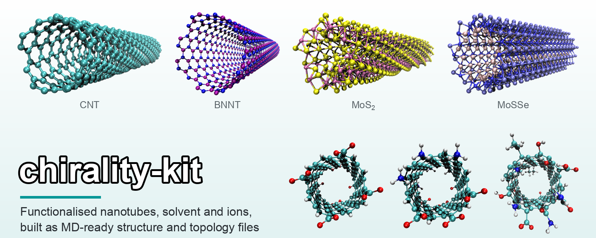

[](LICENSE)
[](#requirements)
[](https://github.com/stepan-zhikh/chirality-kit/releases)

**Builds functionalised nanotubes (CNT, BNNT, MoS₂, MoSSe), graphene walls,
solvent and ions as matched structure and topology files for molecular
dynamics, with CHARMM36m additive and Drude polarisable force fields.**

The repository contains both the original standalone script and an equivalent
split package.

---

## Structure Validation

The tables below give generated structures next to reference values. Every
case is an unsolvated, unfunctionalised, open-ended nanotube built with
`periodic: false`, two translational repeats, and no end caps, from both the
standalone and split implementations. Diameters and chiral angles are compared
with published values, C-C spacings with the experimental graphite spacing, and
axial lengths with the value derived from that spacing.[^1][^4]

These are the as-generated coordinates, before energy minimisation; users can
subsequently relax them with their chosen potential, which may reduce the
initial bond-length deviations. Only carbon-core coordinates and core-core
bonds enter the literature geometry comparisons. Drude particles are tested
separately as force-field bookkeeping invariants.

### Carbon Nanotubes

These structures use the additive CHARMM36m aromatic-carbon type `CG2R61`.[^5]
Lengths are in angstroms.

| Family | `(n,m)` | C cores | C-C bonds | Diameter: generated / published | Chiral angle: generated / published | C-C spacing: min / median / max | Axial length: generated / literature-derived |
|---|---:|---:|---:|---:|---:|---:|---:|
| Armchair | `(8,8)` | 64 / 64 | 80 / 80 | 11.000790 / 10.996[^2] | 30.000 / 30.000[^4] | 1.435888 / 1.439737 / 1.439748[^1] | 4.988306 / 4.925952[^1][^4] |
| Zigzag | `(10,0)` | 80 / 80 | 110 / 110 | 7.939136 / 7.958[^2] | 0.000 / 0.000[^4] | 1.435564 / 1.435565 / 1.440000[^1] | 8.640000 / 8.532000[^1][^4] |
| Chiral | `(9,4)` | 1064 / 1064 | 1583 / 1583 | 9.155858 / 9.156[^3] | 17.480 / 17.480[^3] | 1.434606 / 1.438762 / 1.439961[^1] | 99.641341 / 98.395824[^1][^4] |

### Carbon Nanotubes — Drude-Particle

These structures use the CHARMM Drude aromatic-carbon core `CD2R6A` and particle
`CD2R6A-DRUD`.[^6] The table compares Drude **core-core** geometry only, as it
does for the additive model. Each core additionally has exactly one coincident
Drude particle and one zero-length core-particle bond; the tested core/particle
masses are 11.611/0.400 u, charges are +2.709/-2.709 e, and every complete tube
is neutral.

| Family | `(n,m)` | C cores / Drudes | Core-core / core-Drude bonds | Core diameter: generated / published | Core chiral angle: generated / published | Core-core spacing: min / median / max | Core axial length: generated / literature-derived |
|---|---:|---:|---:|---:|---:|---:|---:|
| Armchair | `(8,8)` | 64 / 64 | 80 / 64 | 11.000790 / 10.996[^2] | 30.000 / 30.000[^4] | 1.435888 / 1.439737 / 1.439748[^1] | 4.988306 / 4.925952[^1][^4] |
| Zigzag | `(10,0)` | 80 / 80 | 110 / 80 | 7.939136 / 7.958[^2] | 0.000 / 0.000[^4] | 1.435564 / 1.435565 / 1.440000[^1] | 8.640000 / 8.532000[^1][^4] |
| Chiral | `(9,4)` | 1064 / 1064 | 1583 / 1064 | 9.155858 / 9.156[^3] | 17.480 / 17.480[^3] | 1.434606 / 1.438762 / 1.439961[^1] | 99.641341 / 98.395824[^1][^4] |

[^1]: P. Trucano and R. Chen, “Structure of graphite by neutron diffraction,” *Nature* **258**, 136–137 (1975), experimental C-C spacing 1.422 ± 0.001 Å. [doi:10.1038/258136a0](https://doi.org/10.1038/258136a0)
[^2]: D. Sánchez-Portal *et al.*, “Ab initio structural, elastic, and vibrational properties of carbon nanotubes,” *Physical Review B* **59**, 12678–12688 (1999), DFT radii 5.498 Å for `(8,8)` and 3.979 Å for `(10,0)`. [doi:10.1103/PhysRevB.59.12678](https://doi.org/10.1103/PhysRevB.59.12678)
[^3]: N. Pierce *et al.*, “Intrinsic Chirality Origination in Carbon Nanotubes,” *ACS Nano* **11**, 9941–9949 (2017), `(9,4)` diameter 9.156 Å and chiral angle 17.48°. [doi:10.1021/acsnano.7b03957](https://doi.org/10.1021/acsnano.7b03957)
[^4]: M. S. Dresselhaus, G. Dresselhaus, and R. Saito, “Physics of carbon nanotubes,” *Carbon* **33**, 883–891 (1995), nanotube geometry, chiral-angle, and translational-period relations. [doi:10.1016/0008-6223(95)00017-8](https://doi.org/10.1016/0008-6223(95)00017-8)
[^5]: K. Vanommeslaeghe *et al.*, “CHARMM general force field: A force field for drug-like molecules compatible with the CHARMM all-atom additive biological force fields,” *Journal of Computational Chemistry* **31**, 671–690 (2010). [doi:10.1002/jcc.21367](https://doi.org/10.1002/jcc.21367)
[^6]: P. E. M. Lopes *et al.*, “Polarizable Empirical Force Field for Aromatic Compounds Based on the Classical Drude Oscillator,” *The Journal of Physical Chemistry B* **111**, 2873–2885 (2007). [doi:10.1021/jp0663614](https://doi.org/10.1021/jp0663614)

---

## Roadmap

These features are planned, but are not implemented yet. I simply have not had
the chance to get to them; suggest others through
[GitHub Issues](https://github.com/stepan-zhikh/chirality-kit/issues):

- Fullerene tubes (capped CNTs).
- Multi-walled carbon nanotubes (MWCNTs).
- Full LAMMPS `.data` support the current output does not yet cover the full format because I do not use LAMMPS in my own workflow, `.xdata` borrows a lot from it, but needs a finished formalised implementation.
- CHARMM-style `.rtf` output, so generated structures can be reused in other workflows with their parameter definitions.
- Other force field parameters and other polarisable force fields could be on the cards if there is a strong need.

---

## Quick start

chirality-kit is not published on PyPI; you clone the repository and run it in
place. There is nothing to install but the one dependency. It requires Python
3.10 or newer and NumPy 2.0 or newer:

```bash
git clone https://github.com/stepan-zhikh/chirality-kit.git
```

```bash
python3 -m pip install "numpy>=2.0"
```

Run either implementation from the repository root. Passing a JSON file is
recommended because the exact input and random seed are archived with the
output:

```bash
python3 src/chirality_kit_monolith/chirality_kit.py \
  --json examples/chirality_kit_input_vacant_sites_dry.json
```

```bash
PYTHONPATH=src python3 -m chirality_kit \
  --json examples/chirality_kit_input_vacant_sites_dry.json
```

Use `--seed 12345` for a reproducible run, `--force-fields
path/to/force-fields` to select a different force-field tree, and `--out-name
path/to/folder` to choose the output folder and generated filename prefix.

The same seed with the same input JSON produces byte-identical `.pdb` and `.psf`
files. The seed may also be given as a top-level `"seed"` key in the input JSON.
Resolution order, highest priority first:

1. `--seed` on the command line
2. `"seed"` in the input JSON
3. `metadata.rng_seed_used` in the input JSON
4. the `SEED` constant in the source
5. a freshly drawn random seed

Because every run records its seed as `metadata.rng_seed_used` in the
`chirality_kit_input.json` it writes to the output folder, and because that key
is honoured on the way back in, **any output folder replays itself**:

```bash
python3 src/chirality_kit_monolith/chirality_kit.py \
  --json previous_run/chirality_kit_input.json
```

reproduces `previous_run` exactly, with no `--seed` needed.

---

## Standalone and Split Layouts

chirality-kit ships two equivalent code layouts:

| Layout | Path | Best for |
|--------|------|----------|
| Standalone monolith | `src/chirality_kit_monolith/chirality_kit.py` | One-file use and simple copying |
| Split package | `src/chirality_kit/` | Importing, extension, and navigation by class or module |

Both layouts expose the same main classes. From the package, with `src` on the
Python path:

```python
from chirality_kit import Config, Geometry, File_Manager, Force_Field_Manager, Structure_Generator, Functional_Group_Generator, Solution_Generator, Sheet_Builder, IO
```

The split package keeps shared runtime defaults in
`src/chirality_kit/_runtime.py`, including `INPUT`, `SEED`, and logging state.
The major classes live one per file:

```
config.py
geometry.py
file_manager.py
force_field_manager.py
structure_generator.py
functional_group_generator.py
solution_generator.py
sheet_builder.py
io.py
```

The split package is not a replacement for the monolith. New behaviour should
stay compatible with both layouts.

---

## What does *chirality-kit* do?

Given a nanotube chirality (n,m) and a set of parameters, chirality-kit:

1. Generates the nanotube atomic structure using the graphene rolling construction
2. Attaches force-field-defined functional groups at terminal, ring, or loose sidewall sites
3. Hydrogen-terminates all remaining under-coordinated carbons
4. Fills the simulation box with solvent using Poisson-disk sampling
5. Places counter-ions for charge neutrality
6. Writes `.pdb`, `.psf`, `.xyz`, and `.data` files plus logs, summaries, and the selected force-field data

---

## Supported Functionality

### Force Fields

The force field is selected by the name of a folder under
`src/force-fields/`. The current repository includes:

| Folder | Nanotube or workflow | Status |
|--------|-----------------------|--------|
| `charmm36m` | Non-polarisable `CNT` | Production |
| `charmm36m-ndp` | Drude-polarisable `CNT-Drude` | Production |
| `placeholder-bnnt-lu2023` | `BNNT` | Placeholder - geometry only |
| `placeholder-mos2-luo2025` | `MoS2NT` | Placeholder - geometry only |
| `placeholder-mosse-rough2026` | `MoSSeNT` | Placeholder - geometry only |

**The `placeholder-*` trees are not parameterisations.** They exist so the
multi-species rollers have something to resolve atom types and bonds against.
Each defines only element names, masses, **zero charges, zero Lennard-Jones
terms**, and a single nominal bond length and stiffness; there are no validated
non-bonded, angle, or dihedral parameters behind them.

What you get from one is therefore **structure and connectivity, not a runnable
force field**: the `.xyz` coordinates are real, and the `.pdb`/`.psf` carry the
correct topology (atoms, bonds, angles, and residues), so the tube can be
visualised, measured, and used as a starting geometry. Handing that `.psf`
straight to an MD engine gives you an uncharged, LJ-free system, which is not a
physical model of the material. Supply your own parameters before running
anything with it.

Additional force-field folders can be dropped into the same directory, or a
different tree selected with `--force-fields`. Nothing about the folder is
hard-coded: the requested `nanotube.type` must exactly match the
`Fragment Nanotube-Species ...` header in the selected force field. Valid
functional groups and solvents are also read from that folder's
`chirality_kit_fragments.xdata` and `chirality_kit_solvents.xdata` files and
are checked before a structure is built.

### Nanostructures

| Structure | `nanotube.type` | Status |
|-----------|-----------------|--------|
| Carbon nanotube | `CNT` | Full structure, topology, functionalisation, and solvation |
| Drude carbon nanotube | `CNT-Drude` | Full structure, topology, functionalisation, and solvation |
| Boron nitride nanotube | `BNNT` | Geometry and connectivity only, via `placeholder-bnnt-lu2023`; no parameters, no functionalisation |
| Molybdenum disulfide nanotube | `MoS2NT` | Geometry and connectivity only, via `placeholder-mos2-luo2025`; no parameters, no functionalisation |
| Janus MoSSe nanotube | `MoSSeNT` | Geometry and connectivity only, via `placeholder-mosse-rough2026`; no parameters, no functionalisation |

### Functionalisation

Functionalisation uses three independent strategies under the
`functionalisation` key: `term`, `rings`, and `loose`. They can be combined;
sites claimed by an earlier strategy are not reused by a later one. The
selected force field determines which fragment names are valid.

#### Terminal groups

`term.groups` targets the under-coordinated carbons at the tube rims:

```json
"term": {
    "term-hydrogenate": true,
    "term-start-highest-x": true,
    "groups": [
        {"type": "COO-", "count": 2, "side": "-"},
        {"type": "CONH2", "count": 2, "side": "+"}
    ]
}
```

`side` is `"both"` by default, `"-"` for the negative-z end, or `"+"` for
the positive-z end. `count` applies independently to every selected side.
After explicit terminal groups are placed, `term-hydrogenate: true` caps all
remaining rim carbons with the force field's `H-term` fragment.
`term-start-highest-x: true` makes the first requested group on each end start
at the eligible carbon with the greatest x coordinate; equal x coordinates are
resolved by the greatest y coordinate. It defaults to `false`, in which case the
starting carbon is drawn from the seeded RNG, so with `false` the start still
varies between seeds, but is reproducible for a given seed like everything else.

#### Rings

`functionalisation.rings` is a list of independent circumferential patterns.
Each ring specification chooses several axial bands, lays out the requested
slots at equal target angles, and snaps those targets to the nearest
unoccupied nanotube atoms:

```json
"rings": [
    {
        "ring-count": 12,
        "ring-placement": "external",
        "ring-padding": true,
        "ring-phase-start-offset": 0.0,
        "ring-phase-increment": 0.5235987756,
        "groups": [
            {"type": "OH-", "count": 2},
            {"type": "VACANT", "count": 2}
        ]
    }
]
```

| Ring field | Meaning |
|------------|---------|
| `ring-count` | Number of axial bands. The `groups` pattern is repeated at every band. |
| `ring-placement` | `"external"` points fragments away from the tube; `"internal"` points them into the pore. |
| `ring-padding` | `true` insets the first and last bands from the rims; `false` spans the full tube length. |
| `ring-phase-start-offset` | Rotation of the first pattern around the tube, in radians. |
| `ring-phase-increment` | Additional rotation per successive band, in radians. `0` produces columns; a nonzero value produces a twist or helix. |
| `groups` | Ordered fragment types and slot counts **per band**. |

In the example, each band has four target slots but only two real `OH-`
attachments. Across 12 bands that gives 24 attached groups. The two `VACANT`
entries keep their sites empty in the angular pattern.

#### Vacant sites

`VACANT` marks an attachment site that is left empty. It is supported in
`term.groups` and ring `groups`, takes part in the ordered spacing pattern, and
is removed before topology and coordinate files are written; no force-field
fragment named `VACANT` is required. A vacant ring site leaves its sidewall
atom unchanged. A vacant terminal site is capped with `H-term` only when
`term-hydrogenate` is enabled. Inputs written before 0.8.0 may use `DUMMY`,
which is read as `VACANT` with a note in the log.

#### Loose sidewall groups

`loose.groups` places fragments on otherwise free sidewall atoms:

```json
"loose": {
    "groups": [
        {
            "type": "NH2-",
            "count": 6,
            "loose-placement": "random-external",
            "z-from": 0.35,
            "z-to": 0.65
        },
        {
            "type": "OH-",
            "loose-placement": "all-internal",
            "z-from": 0.90,
            "z-to": 1.0
        }
    ]
}
```

The supported modes are `random-external`, `random-internal`,
`all-external`, and `all-internal`. `z-from` and `z-to` are normalised axial
coordinates from 0 to 1 and apply to both random and all-site modes. `count`
is required for random modes and ignored for all-site modes. Loose entries
are processed in list order.

See the [full functionalisation tutorial](tutorials/tutorial.md#5-functionalisation)
for columns, helices, internal/external bands, mixed chemistry, terminal
patterns, and vacant sites.

### Solvents and Ions

`placement: "packed"` uses Bridson Poisson-disk centres for molecular
solvents; `placement: "ionic"` places the ions parsed from a salt formula such
as `KCl`, with optional charge neutralisation. Common bundled solvent names
include `TIP3`, `SPCE`, and `SWM4`, but availability is force-field-specific
and validated from `chirality_kit_solvents.xdata`.

Packed molecules are independently oriented with Shoemake/Marsaglia unit
quaternions. The resulting molecular rotations are Haar-uniform on `SO(3)`:
any molecule-fixed axis is uniform on `S²`, including a uniform roll about
that axis. The rigid proper rotations preserve bond geometry and chirality.

#### `min_distance`

`min_distance` is the minimum separation in Ångström, default `2.0`. It does two
jobs: it is the cutoff for the post-injection overlap cull, and in the packed
path it is the floor on the Bridson exclusion radius, so solvent centres are
generated at least this far apart rather than only being culled afterwards.

Raising it therefore constrains how many molecules fit. If a requested `count`
or `concentration` cannot be reached at that floor the run fails with a message
naming `min_distance` as one of the things to change.

It applies only to pairs the group being injected is part of. Atoms already in the
system keep whatever separation their own injection established, so a later group
with a larger `min_distance` cannot retroactively cull pairs an earlier one already
resolved.

#### The bulk phase

The packed solvation group with the **highest** `priority` number is the bulk
phase, and its molecules are the only ones never checked against each other during
overlap removal. There is no key for this; it is derived from the group priorities
at validation and reported in the log.

The exemption is needed because bulk spacing comes from Bridson's centre-to-centre
radius, not from `min_distance`. Bridson separates molecular *centres* while
`min_distance` separates *atoms*, so neighbouring bulk molecules routinely sit
closer than `min_distance` atom-to-atom without anything being wrong; policing them
there would delete a large share of the box.

Only one group can hold the exemption, and only a packed one. Two groups sharing
the highest priority would never be checked against each other and would
interpenetrate silently, so that is a validation error. Ionic groups can never hold
it; ionic placement relies on the cull to catch two ions landing on each other.

To add a second solvent, give it a lower `priority` number than the bulk; it is
then culled against the bulk. That is correct while it stays dilute enough for its
own Bridson radius to clear `min_distance`. A true 50/50 co-solvent mixture is not
supported because both phases would need self-exemption while still being checked against
each other, which needs cross-phase neighbour search.

#### Multiple salts

Solvation groups are injected in **priority order, highest number first**. The
bulk phase goes in first and each later group, being more important, carves its
space out of what is already there. Groups sharing a priority keep the order they
were written in. Ions accumulate: a later ionic group is given the positions of
every ion already placed via the `.salts` record, so this holds even when a
packed solvent group sits between two salts, and rejects any position within
`min_distance` of one. If no valid position is found within 10,000 attempts the
run raises rather than placing an overlapping ion.

**Charge neutrality is applied by the last ionic group only**, meaning last in injection
order, so the ionic group with the *lowest* priority number. A `charge-neutrality: true`
on any earlier group is deferred, with a warning naming the group. This is
deliberate: each correction is computed from the system charge at the moment it
runs, so applying it once per salt means later corrections react to charge the
earlier ones already cancelled, and the system ends up charged. Only the last
group sees the fully accumulated charge.

The rule is that the last group *may* neutralise, not that it must. Setting
`charge-neutrality: false` on the last ionic group leaves the system
deliberately charged, and nothing overrides that.

Note that ions are excluded from a single axis-aligned bounding box around the
structure, not from a per-atom envelope, so they are kept out of the whole
cuboid enclosing the nanotube, including its interior channel.

#### `side`

Each solvation group can be placed in part of the box. The values follow the
terminal groups' `side`, with `"-"` for the negative-z end and `"+"` for the
positive-z end:

| `side` | Where the group goes |
| --- | --- |
| `"full"` | The whole box. The default, used whenever `side` is absent. |
| `"-"` | Below the tube: from the box end to the lower boundary. |
| `"+"` | Above the tube: from the upper boundary to the box end. |
| `"both"` | The `"-"` and `"+"` sides together: nothing around or inside the tube. |
| `"around-tube"` | The slab around the tube, outside it, between the two boundaries. |

With `system.tube-sheets` the boundaries are the tube-end sheet planes, kept
`wall-gap` clear; otherwise they are the z range of the `TUBE` residue. A
`concentration` counts the volume of the group's region. A packed `"both"` group
is placed on each side in turn, and an explicit `count` is split between the
sides by their length. The neutralising ions
of the last ionic group go into that group's region, so to put salt on one side
and counter-ions on both, use two ionic groups. `side` needs a nanotube. A
one-sided group in a box with no walls is allowed with a warning, because its
two sides meet across the periodic boundary.

### Graphene sheets

> **Status:** the graphene walls (box ends since 0.7.0, tube ends since 0.8.0)
> are still being tested in production simulations. Check a walled build before
> relying on it, and report anything unexpected through
> [GitHub Issues](https://github.com/stepan-zhikh/chirality-kit/issues).

`Sheet_Builder` closes a system with periodic graphene walls of two kinds, used
alone or together:

- **Box-end walls** (`system.sheets`): a sheet below the lowest atom and one
  above the highest, so the tube is the only route between the two reservoirs.
- **Tube-end walls** (`system.tube-sheets`): a sheet at each end of the tube, in
  the plane of the innermost rim carbon, with a round hole the tube passes
  through. The solvent in the annulus between them is removed when the system
  is built.

Every sheet is made of the tube's carbon species (with its Drude particle in
polarisable force fields), is bonded across the x and y boundaries and is
exactly neutral. The tube is never bonded to a sheet. Both kinds read one
`sheets` block; every key is optional and these are the defaults:

```json
"system": { "...": "...", "sheets": true, "tube-sheets": false },
"sheets": {
    "orientation": "zigzag-x",
    "wall-gap": 3.0,
    "seam-gap": 15.0,
    "hole-buffer": 2.5,
    "rim-offset": 0.0,
    "resnames": { "z-min": "SHTN", "z-max": "SHTP",
                  "tube-z-min": "MEMN", "tube-z-max": "MEMP" }
}
```

| Key | Used by | Meaning |
| --- | --- | --- |
| `orientation` | both | `zigzag-x` puts the zigzag direction (period √3·b, 2.494 Å) along x and the armchair direction (period 3·b, 4.320 Å) along y; `armchair-x` swaps them. |
| `wall-gap` | both | Box-end walls: distance from each sheet to the outermost atom. Tube-end walls: solvent-free distance around each sheet's carbons. In Å. |
| `seam-gap` | box-end | Vacuum between the z-max sheet and the periodic image of the z-min sheet, in Å. |
| `hole-buffer` | tube-end | Added to the tube radius R to give the hole radius, in Å. |
| `rim-offset` | tube-end | Moves each sheet along the tube from the innermost rim carbon, in Å: positive outward (at most to the outermost rim carbon), negative inward. Default 0. |
| `resnames` | both | Residue name of each sheet, 1–4 uppercase letters or digits, all different and clear of `TUBE`, `IONS`, `SYS`, the ion and solvent names and `END`. |

**The box is rounded up to the lattice.** A periodic sheet must be a whole
number of graphene cells, so with walls (or a `sheets` block) the box x and y
are rounded up to the next whole cell before any solvent goes in, about the box
centre. The increase is under one cell (2.494 Å or 4.320 Å) per axis, it
applies to an explicit `size` as well as an `"auto"` box, and the box is never
made smaller. The log and the `.summary` give the requested and the applied
size.

**Walls on and off give the same system.** With the same `sheets` block and
seed, a build with box-end walls and one without are identical in every tube,
solvent and ion atom.

**The exact box is written out.** Walled builds write a `CRYST1` line in the
`.pdb`, the box in the `.data` header and a `<system-name>.xsc`. Read the cell
from the `.xsc`: the atom extents of the `.pdb` are slightly smaller than a
periodic sheet needs.

The walls need a carbon tube (`CNT` or `CNT-Drude`) that is not periodic. The
full reference, including the `side` key that places solvent on one side of the
tube, is in [tutorial Section 7](tutorials/tutorial.md#7-graphene-walls).

### Output formats

| Requested extension | Output |
|---------------------|--------|
| `.pdb` | Coordinates for molecular visualisation; also creates `restraints.ref` |
| `.psf` | CHARMM/NAMD-style topology |
| `.xyz` | Coordinates without topology |
| `.data` | LAMMPS data file |

Every run also writes the internal `.xdata`, a `.log`, a `.summary`, the
resolved `chirality_kit_input.json` including the RNG seed, and a copy of the
selected force-field directory. Builds with a `sheets` block also write the
exact box as `<system-name>.xsc`, and sheets-on builds keep each sheet's
coordinates as `<system-name>_sheet_zmin.xyz` and `_sheet_zmax.xyz`.

Two sidecar records are written alongside them:

| File | Contents |
| --- | --- |
| `.nanotube` | The covalent structure, including tube atoms **and functional groups**, despite the name. Written once, after functionalisation and before solvation. Absent when `"nanotube": false`. |
| `.salts` | One record per placed ion, rewritten after each ionic group. Ion cores only; the coincident Drude particle of a polarisable ion is not recorded. |

Format is `index type residue x y z`, one atom per line. Ionic placement reads
these instead of re-parsing the main `.xdata`, which runs to tens of thousands
of lines once solvent is in, and `.salts` is what lets a later salt see an
earlier one's ions. Both are regenerated from scratch every run. A stale copy
would silently exclude regions of a fresh box, so do not hand-edit them or copy
them between runs.

---

## Usage

The recommended input is a JSON file. This complete dry example combines
terminal groups, helical external rings, and random internal sidewall groups:

```json
{
    "settings": {
        "system_name": "auto",
        "verbose": false,
        "output_types": [".pdb", ".psf", ".xyz", ".data"],
        "adjust-ion-partial-charge": false,
        "bonds": true,
        "angles": true,
        "dihedrals": true,
        "impropers": true,
        "lone-pairs": true,
        "anisotropy": true
    },
    "system": {
        "force-field": "CHARMM36m",
        "size": "auto",
        "size-padding-xy": 14.0,
        "size-padding-z": 30.0,
        "nanotube": true,
        "functionalisation": true,
        "solvation": false,
        "pbc-override": false
    },
    "nanotube": {
        "type": "CNT",
        "n": 8,
        "m": 4,
        "repeats": 3
    },
    "functionalisation": {
        "term": {
            "term-hydrogenate": true,
            "groups": [
                {"type": "COO-", "count": 2, "side": "-"}
            ]
        },
        "rings": [
            {
                "ring-count": 3,
                "ring-placement": "external",
                "ring-padding": true,
                "ring-phase-start-offset": 0.0,
                "ring-phase-increment": 0.5235987756,
                "groups": [
                    {"type": "OH-", "count": 2},
                    {"type": "VACANT", "count": 2}
                ]
            }
        ],
        "loose": {
            "groups": [
                {
                    "type": "H+",
                    "count": 4,
                    "loose-placement": "random-internal",
                    "z-from": 0.35,
                    "z-to": 0.65
                }
            ]
        }
    },
    "solvation": {
        "groups": []
    }
}
```

Save it as `input.json`, then run either layout:

```bash
python3 src/chirality_kit_monolith/chirality_kit.py --json input.json
PYTHONPATH=src python3 -m chirality_kit --json input.json
```

Both entry points accept the same options:

```bash
--force-fields path/to/force-fields
--seed 12345
--out-name path/to/folder
```

The `--force-fields` path must point to a directory literally named
`force-fields`. Without `--json`, the standalone script uses the `INPUT`
dictionary in `src/chirality_kit_monolith/chirality_kit.py`; the split package
uses the copy in `src/chirality_kit/_runtime.py`.

The six topology-section settings are required booleans. Setting one to
`false` prevents that section from being created in `.xdata`; its template
records and force-field types are not looked up. If every bonded section is
disabled, bond-network discovery is skipped too. Subsequent formats inherit the
filtered `.xdata`; format-required PSF blocks remain present with a zero count.

For automatic boxes, `pbc-override: false` clamps x/y and z padding to the
recommended minimum of 14 Å. Setting it to `true` permits smaller requested
padding but does not suppress periodic-image safety warnings.

---

## Output

Each run creates a new folder in the current working directory. `--out-name`
accepts either a folder name (relative to the current working directory) or a
path and overrides the JSON `system_name`. Without it, the JSON name is used;
`"auto"` generates the system name as before. Generated files use the final
folder's basename. If the chosen name already exists, `_(1)`, `_(2)`, and so
on are tried until the path is unique:

```
<system-name>/
├── <system-name>.xdata
├── <system-name>.pdb       # when requested
├── <system-name>.psf       # when requested
├── <system-name>.xyz       # when requested
├── <system-name>.data      # when requested
├── <system-name>.log
├── <system-name>.summary
├── <system-name>.xsc       # with a "sheets" block
├── <system-name>_sheet_zmin.xyz   # with system.sheets
├── <system-name>_sheet_zmax.xyz   # with system.sheets
├── <system-name>_tube_sheet_zmin.xyz   # with system.tube-sheets
├── <system-name>_tube_sheet_zmax.xyz   # with system.tube-sheets
├── <system-name>.carved    # with system.tube-sheets: the removed solvent
├── restraints.ref          # when .pdb is requested
├── chirality_kit_input.json
└── <force-field>/           # copied parameter and xdata files
```

The summary and log record:

- nanotube geometry and atom count;
- terminal, ring, and loose functionalisation settings;
- solvation counts and achieved concentration;
- box dimensions and periodic-image checks;
- nanotube, solution, and total charge.

---

## Directory layout

Both layouts and the shared force-field folder are kept under `src/`:

```
src/
├── chirality_kit_monolith/
│   └── chirality_kit.py
├── chirality_kit/
│   ├── __init__.py
│   ├── __main__.py
│   ├── _runtime.py
│   ├── config.py
│   ├── geometry.py
│   ├── file_manager.py
│   ├── force_field_manager.py
│   ├── structure_generator.py
│   ├── functional_group_generator.py
│   ├── solution_generator.py
│   ├── sheet_builder.py
│   └── io.py
└── force-fields/
    ├── README.md          provenance and licensing of the bundled parameters
    ├── LICENSE.charmm     upstream licence for the CHARMM toppar trees
    └── .../
```

If you copy only the standalone script elsewhere, keep a `force-fields/` folder next to it or pass `--force-fields`.

---

## Requirements

| Requirement | Version |
|-------------|---------|
| Python | 3.10 or newer |
| NumPy | 2.0 or newer |

---

## Documentation and examples

- [Full tutorial](tutorials/tutorial.md)
- [Force-field fragment and solvent conventions](tutorials/conventions.md)
- [Force-field provenance and licensing](src/force-fields/README.md)
- [Additional JSON inputs](examples/)

The `examples/` folder is the best source of small, runnable inputs for
terminal patterns, vacant sites, loose placement, and solvated systems.

---

## Licence

chirality-kit is released under the [MIT licence](LICENSE).

The repository also redistributes CHARMM topology and parameter files, which are
the work of the MacKerell lab and not of chirality-kit. They are covered by their
own MIT licence; see [`NOTICE`](NOTICE) and
[`src/force-fields/README.md`](src/force-fields/README.md) for provenance,
attribution, and the force-field references you should cite.

---

## Citing chirality-kit

Citation metadata is in [`CITATION.cff`](CITATION.cff); GitHub renders it as a
"Cite this repository" button. Please cite the version you used, and cite the
authors of any force field you simulated with as well.

---

## Use of AI

AI coding assistants were used in developing this repository, for writing and
testing code and for debugging, always under the author’s direction. Every
single line before the public release (yes, even the doc strings) was written by
the author (yours truly), but the project has now grown in scope, hence I cannot
continue to maintain it alone. Nothing was added autonomously, as every change
was reviewed and accepted by me. All issues and feature requests are read and
answered by a single person (me).

---

## Contact & support

Please report bugs, ask questions, and suggest features through
[GitHub Issues](https://github.com/stepan-zhikh/chirality-kit/issues).

This project is maintained by one person.
