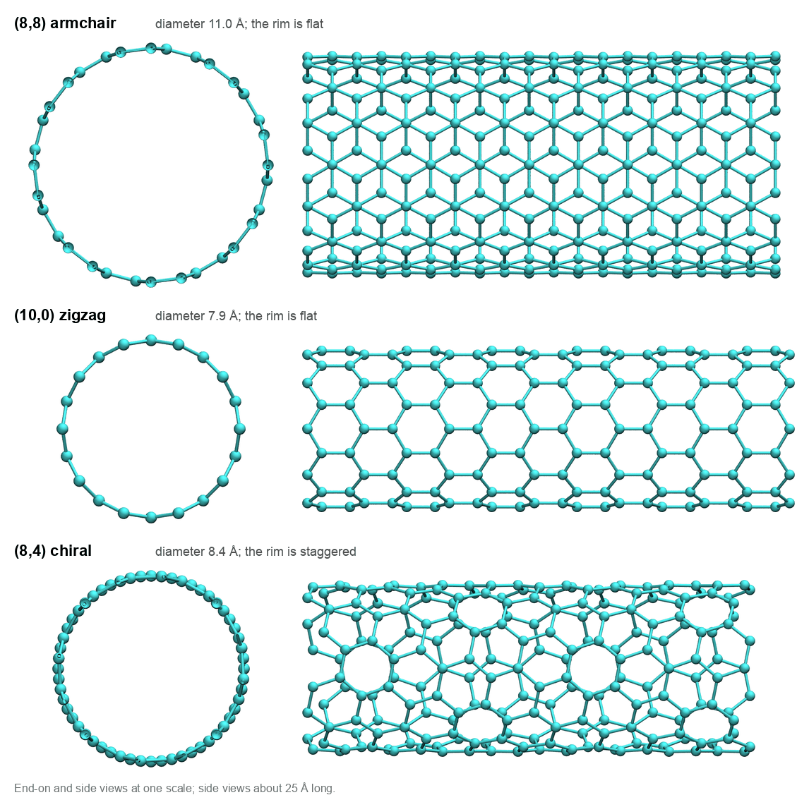
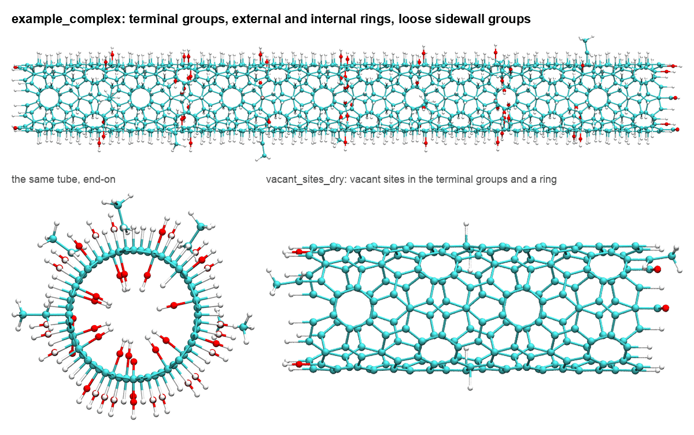
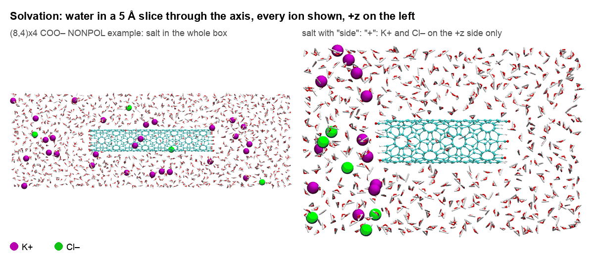
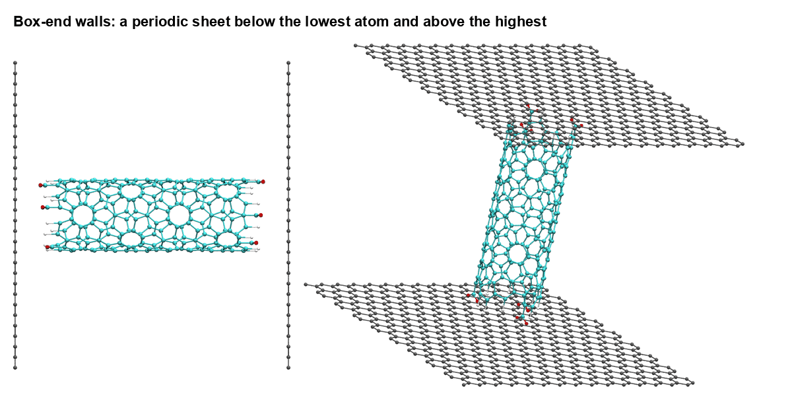
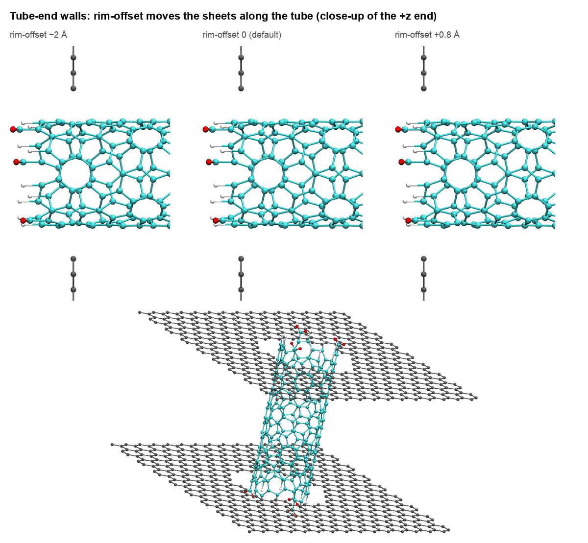

# chirality-kit Tutorial

**chirality-kit** builds complete MD structure and topology files for functionalised nanostructures. Describe the system you want in one JSON file (or in the built-in `INPUT` dictionary), run the tool, and your output folder is ready.

---

## Contents

1. [Prerequisites and setup](#1-prerequisites-and-setup)
2. [The INPUT dictionary](#2-the-input-dictionary); [2.1 Command line](#21-command-line)
3. [Minimal example: bare CNT](#3-minimal-example-bare-cnt)
4. [Chirality and geometry](#4-chirality-and-geometry)
5. [Functionalisation](#5-functionalisation)
6. [Solvation](#6-solvation)
7. [Graphene walls](#7-graphene-walls)
8. [Force field selection](#8-force-field-selection)
9. [Understanding the output](#9-understanding-the-output)
10. [Common recipes](#10-common-recipes)
11. [Tips and known limitations](#11-tips-and-known-limitations)
12. [Bonus: XYZ generation for MLIPs](#12-bonus-xyz-generation-for-mlips)


---

## 1. Prerequisites and setup

chirality-kit needs **Python 3.10 or newer** and one external dependency, **numpy 2.0 or newer**:

```bash
python3 -m pip install "numpy>=2.0"
```

### Directory layout

The repository ships two equivalent implementations of the same tool: a single-file
script and a split package, plus the force-field data they both read:

```
src/
    chirality_kit_monolith/
        chirality_kit.py          single-file implementation
    chirality_kit/          package implementation (same behaviour)
    force-fields/
        charmm36m/
            chirality_kit_fragments.xdata
            chirality_kit_solvents.xdata
            toppar/
        charmm36m-ndp/
            chirality_kit_fragments.xdata
            chirality_kit_solvents.xdata
            toppar/
```

Pick whichever implementation you prefer; they produce identical output. The
force-field tree is found automatically next to the code, or pointed at
explicitly with `--force-fields` (Section 2.1).

### Running it

From the repository root, with a JSON input file:

```bash
PYTHONPATH=src python3 -m chirality_kit --json examples/chirality_kit_input_vacant_sites_dry.json
```

or the single-file version:

```bash
python3 src/chirality_kit_monolith/chirality_kit.py --json examples/chirality_kit_input_vacant_sites_dry.json
```

With no `--json`, the built-in `INPUT` dictionary in the source is used instead.
Output is written to a new folder in your current working directory, named
automatically from your settings unless you pass `--out-name`.

---

## 2. The INPUT dictionary

Every setting lives in one dictionary. You can edit the `INPUT` dict in the
source and run with no arguments or, as recommended, keep it as a JSON file and
pass it with `--json`, which archives the exact input and RNG seed alongside the
output so the run can be replayed (Section 2.1).

The dictionary has six main top-level keys, plus an optional seventh:

```
"metadata"          version info, plus the archived RNG seed
"settings"          system name, output formats, topology sections
"system"            force field, box size, what to build
"nanotube"          CNT chirality and length
"functionalisation" which groups, how many, where
"solvation"         solvent species and placement
"sheets"            optional: graphene walls, at the box ends or the tube ends (Section 7)
```

### `settings`

| Key | Type | Description |
|-----|------|-------------|
| `system_name` | str | Output folder name. `"auto"` generates one from your settings. |
| `verbose` | bool | Extra logging for debugging. |
| `output_types` | list | Formats to write. Any subset of `[".pdb", ".psf", ".xyz", ".data"]`. |
| `adjust-ion-partial-charge` | bool | If `true`, adjust the last eligible ion core charge in the final PSF to remove fractional residual charge. Requires an eligible ion in the PSF, normally from `placement: "ionic"`. |
| `bonds` | bool | Write the bond section. Required key. |
| `angles` | bool | Write the angle section. Required key. |
| `dihedrals` | bool | Write the dihedral section. Required key. |
| `impropers` | bool | Write the improper section. Required key. |
| `lone-pairs` | bool | Write the lone-pair section (Drude force fields). Required key. |
| `anisotropy` | bool | Write the anisotropy section (Drude force fields). Required key. |

The six topology-section switches are all mandatory; the run stops with
`Missing required settings: ...` if any is absent. Set one to `false` to omit
that section from the generated files.

### `system`

| Key | Type | Description |
|-----|------|-------------|
| `force-field` | str | `"CHARMM36m"` or `"CHARMM36m-NDP"` |
| `size` | str or list | `"auto"` derives box from tube geometry + padding values. |
| `size-padding-xy` | float | Box padding around the tube in x/y (Angstrom). Minimum 14. |
| `size-padding-z` | float | Box padding beyond the tube ends in z (Angstrom). |
| `pbc-override` | bool | If `true`, keep padding values smaller than the recommended minimum instead of raising them. See below. |
| `nanotube` | bool | Build a nanotube. |
| `functionalisation` | bool | Attach functional groups. |
| `solvation` | bool | Fill with solvent. |
| `sheets` | bool | Close the box ends with graphene walls (Section 7). Default `false`. |
| `tube-sheets` | bool | Put holed graphene walls at the two tube ends (Section 7.4). Default `false`. |

**`pbc-override`**: with `"size": "auto"`, a `size-padding-xy` or
`size-padding-z` below the recommended 14 Angstrom is raised to 14 Angstrom, so a run cannot
silently produce a box in which the system sees its own periodic image. Setting
`"pbc-override": true` keeps your smaller values as given and logs that it did
so. It applies to automatic box construction only; an explicit `size` list is
always used exactly as written (Section 11).

Use it when you deliberately want a tighter cell than the default and accept
responsibility for the image interactions. It has nothing to do with
`nanotube.periodic`: this one only relaxes a box check, it does not change how
the structure is built.

---

## 2.1 Command line

Both implementations take the same four arguments.

| Flag | Effect |
|------|--------|
| `--json FILE` | Read the input from a JSON file, replacing the built-in `INPUT` dict entirely. |
| `--seed N` | Integer RNG seed for a reproducible run. |
| `--force-fields PATH` | Use a different force-field tree. The folder must be named exactly `force-fields`. |
| `--out-name PATH` | Output folder path or name; the generated files take the folder's basename as their prefix. |

### Reproducibility and replay

The same seed with the same input JSON produces byte-identical `.pdb` and `.psf`
files. The seed is resolved from the first of these that is present:

1. `--seed` on the command line
2. a top-level `"seed"` key in the input JSON
3. `metadata.rng_seed_used` in the input JSON
4. the `SEED` constant in the source
5. a freshly drawn random seed

Every run writes its own input back out as `chirality_kit_input.json` in the
output folder, with the seed it actually used recorded as
`metadata.rng_seed_used`. Because that key is read back in at position 3,
**any output folder replays itself**:

```bash
PYTHONPATH=src python3 -m chirality_kit --json previous_run/chirality_kit_input.json
```

reproduces `previous_run` exactly, with no `--seed` needed.

---

## 3. Minimal example: bare CNT

This builds a (10,10) armchair CNT with 5 unit cells, no functionalisation, no solvent.

```python
INPUT = {
    "metadata": {
        "made-by": "chirality-kit",
        "version": "0.8.0",
        "creator": "your name",
        "filename": "chirality_kit.py"
    },

    "settings": {
        "system_name": "auto",
        "verbose": False,
        "output_types": [".pdb", ".psf", ".xyz", ".data"],
        "adjust-ion-partial-charge": False,
        "bonds": True,
        "angles": True,
        "dihedrals": True,
        "impropers": True,
        "lone-pairs": True,
        "anisotropy": True
    },

    "system": {
        "force-field": "CHARMM36m",
        "size": "auto",
        "size-padding-xy": 14.0,
        "size-padding-z": 30.0,
        "nanotube": True,
        "functionalisation": False,
        "solvation": False
    },

    "nanotube": {
        "type": "CNT",
        "n": 10,
        "m": 10,
        "repeats": 5,
        "periodic": False
    }
}
```

After running, a folder appears in your working directory:

```
CHARMM36m_CNT_(10,10)x5/
    CHARMM36m_CNT_(10,10)x5.xdata
    CHARMM36m_CNT_(10,10)x5.pdb
    CHARMM36m_CNT_(10,10)x5.psf
    CHARMM36m_CNT_(10,10)x5.xyz
    CHARMM36m_CNT_(10,10)x5.data
    CHARMM36m_CNT_(10,10)x5.log
    CHARMM36m_CNT_(10,10)x5.summary
    CHARMM36m_CNT_(10,10)x5.nanotube
    SW-CNT_10_10_5.xyz
    restraints.ref
    charmm36m/
    chirality_kit_input.json
```

A solvated run with ionic groups also writes a `.salts` record. Every file is
described in Section 9.

---

## 4. Chirality and geometry

The `nanotube` block controls the tube geometry.



*The three tube families at one scale: (8,8) armchair, (10,0) zigzag and (8,4) chiral. Built from [`fig_tube_armchair_8_8.json`](../docs/tutorial/inputs/fig_tube_armchair_8_8.json), [`fig_tube_zigzag_10_0.json`](../docs/tutorial/inputs/fig_tube_zigzag_10_0.json) and [`fig_tube_chiral_8_4.json`](../docs/tutorial/inputs/fig_tube_chiral_8_4.json), seed 12345.*

```python
"nanotube": {
    "type": "CNT",   # "CNT", "BNNT", "MoS2NT", or "MoSSeNT"
    "n": 8,          # chiral index n
    "m": 4,          # chiral index m
    "repeats": 3,     # unit cells stacked along the tube axis
    "periodic": False,# opt-in axial PBC; leave off for finite tubes (see Section 11)
    "outer-chalcogen": "Se"  # MoSSeNT only: "Se" (default) or "S" on the outside
}
```

`periodic` defaults to `False` for every type. Turn it on only if you want a tube bonded across the z boundary for a periodic simulation; it deliberately leaves the last-cell atoms with a single bond. See Section 11 for the details and the log lines to check.

`outer-chalcogen` is read only for `"MoSSeNT"`/`"MoSSe"` and chooses which face of
the Janus wall carries which chalcogen: `"Se"` (the default) puts selenium on the
outer shell and sulfur on the inner one, `"S"` swaps them. Any other value stops
the run with a validation error. It is ignored by every other tube type.

Multi-species tubes are built against the **placeholder** force fields:
`placeholder-bnnt-lu2023` for `"BNNT"`, `placeholder-mos2-luo2025` for
`"MoS2NT"`, `placeholder-mosse-rough2026` for `"MoSSeNT"`. As with any force
field, the `Fragment Nanotube-Species` header must match `type` exactly.

**These give you geometry and connectivity, not a parameterised model.** Each
placeholder tree carries element names, masses, zero charges, zero
Lennard-Jones terms, and one nominal bond length, with nothing validated. The `.xyz`
coordinates and the `.pdb`/`.psf` topology are correct and usable for
visualisation, measurement, or as a starting structure, but the resulting system
has no real interactions: run it as-is and every atom is uncharged and
LJ-free. Supply your own parameters before simulating. Functionalisation is
intentionally disabled for these materials until attachment-site logic becomes
material-aware.

### Chirality types

| Condition | Type | Examples |
|-----------|------|---------|
| `m == 0` | zigzag | (8,0), (10,0) |
| `n == m` | armchair | (8,8), (10,10) |
| otherwise | chiral | (8,4), (6,2) |

### What `repeats` controls

`repeats` stacks that many translational unit cells end-to-end. The actual tube length depends on both the chirality and the repeat count. On every run, chirality-kit prints the exact geometry:

```
====================================================
  CNT GEOMETRY  C(8,4) x 3
====================================================
  Type          : chiral
  Radius        : 4.069 Ang
  Length        : 22.684 Ang
  Chiral angle  : 19.11 deg
  Atoms/cell    : 112
  Total atoms   : 336
====================================================
```

This is also saved to the `.summary` file in the output folder.

---

## 5. Functionalisation

Set `"functionalisation": True` in the `system` block, then configure the `functionalisation` section. The section is split into three independent placement strategies: **term**, **rings**, and **loose**, which can be used in any combination.



*Top and bottom left: the complex example without solvent ([`fig_functionalisation_complex_dry.json`](../docs/tutorial/inputs/fig_functionalisation_complex_dry.json)). Bottom right: vacant sites ([`chirality_kit_input_vacant_sites_dry.json`](../examples/chirality_kit_input_vacant_sites_dry.json)). Seed 12345.*

### Available functional groups

The groups you can use are exactly the `Fragment` entries of the selected force
field, so the list depends on `force-field`. For `CHARMM36m`:

| Name | Fragment charge (e) | Notes |
|------|--------------------|-------|
| `"COO-"` | -1.000 | Carboxylate |
| `"COOH"` | -0.080 | Carboxylic acid |
| `"OH-"` | -1.000 | Hydroxyl |
| `"C2H5"` | 0.000 | Ethyl |
| `"CONH2"` | +0.020 | Amide |
| `"NH2-"` | -0.050 | Amine |
| `"NH3+"` | +0.690 | Protonated amine |
| `"CH2NH3+"` | +0.910 | Methylene-linked protonated amine |
| `"NH3+-CPEA"` | +0.580 | Protonated amine, phenyl-ethyl linker |
| `"NH3+-CPOA"` | +0.590 | Protonated amine, longer linker |
| `"H+"` or `"H-term"` | +0.022 | Hydrogen; also used by automatic hydrogenation |
| `"VACANT"` | N/A | An empty site in term and ring placement; never written as a fragment |

The charge column is the net charge of the fragment's own atoms, summed straight
from the `.xdata`. Several are deliberately non-integer because the parameter sets they
come from spread the remaining charge onto the carbon the group attaches to, so
a functionalised tube commonly carries a fractional total charge. The two charge
controls do different jobs: `charge-neutrality` on an ionic group adds whole ions
during solvation, while `adjust-ion-partial-charge` in `settings` edits one
eligible ion core charge in the final PSF (Section 6).

`CHARMM36m-NDP` is a smaller set (`COO-`, `CH3`, `H+`, and `H-term`) with no
hydroxyl or ethyl. To see what any force field offers, read the `Fragment`
headers in its `chirality_kit_fragments.xdata`:

```bash
grep "^Fragment" src/force-fields/charmm36m/chirality_kit_fragments.xdata
```

Asking for a group the force field does not define stops the run with a
validation error before any files are written.

---

### 5.1 Term: end-cap groups

The `term` block places functional groups on the under-coordinated edge carbons at the tube entry (z < 0) and/or exit (z > 0) ends. After all term groups are placed, `term-hydrogenate` caps any remaining edge carbons with hydrogen.

```json
"functionalisation": {
    "term": {
        "term-hydrogenate": true,
        "term-start-highest-x": true,
        "groups": [
            { "type": "COO-", "count": 2, "side": "both" },
            { "type": "OH-",  "count": 4, "side": "-" }
        ]
    }
}
```

| Field | Description |
|-------|-------------|
| `term-hydrogenate` | Cap all remaining edge carbons with H after term groups are placed |
| `term-start-highest-x` | Start terminal placement at the highest-x eligible carbon on each end, breaking x ties by highest y; defaults to random placement when false or omitted |
| `count` | Number of groups per side (both ends by default) |
| `side` | `"both"` (default), `"-"` for the negative-z end, or `"+"` for the positive-z end |

With `term-start-highest-x: true`, terminal locations are pinned to the
highest-x carbon and do not depend on the RNG at all. With the default `false`
the starting carbon is drawn from the seeded stream, so locations vary between
seeds but are reproducible for any given seed.

---

### 5.2 Rings: circumferential bands

The `rings` block places groups in discrete axial bands, each containing one complete circumferential ring of sites. Multiple ring specs can be listed and are placed independently.

```json
"functionalisation": {
    "rings": [
        {
            "ring-count": 7,
            "ring-placement": "external",
            "ring-padding": true,
            "ring-phase-increment": 0.7854,
            "ring-phase-start-offset": 0.0,
            "groups": [
                { "type": "C2H5", "count": 1 },
                { "type": "OH-",  "count": 5 }
            ]
        },
        {
            "ring-count": 3,
            "ring-placement": "internal",
            "ring-padding": true,
            "ring-phase-increment": 0.7854,
            "ring-phase-start-offset": 0.0,
            "groups": [
                { "type": "H+", "count": 1 },
                { "type": "OH-", "count": 5 }
            ]
        }
    ]
}
```

| Field | Description |
|-------|-------------|
| `ring-count` | Number of axial rings to place |
| `ring-placement` | `"external"` or `"internal"` |
| `ring-padding` | Skip the outermost z-positions to avoid the tube tips |
| `ring-phase-increment` | Angular offset (radians) between successive rings; use `2*pi/groups_per_ring` for staggering |
| `ring-phase-start-offset` | Starting angular offset for the first ring |
| `groups` | List of group types and counts per ring. All counts are repeated for every ring in `ring-count`. |

### 5.3 Vacant sites

Group entries are expanded in list order before the attachment sites are
chosen. `VACANT` takes part in that sequence and therefore controls the
spacing, but it is removed before fragments are attached or output files are
written.

For example, this defines eight sites around each ring. Only the first and
fourth sites receive groups:

```json
"groups": [
    { "type": "COO-", "count": 1 },
    { "type": "VACANT", "count": 2 },
    { "type": "OH-", "count": 1 },
    { "type": "VACANT", "count": 4 }
]
```

The same pattern can be used for a selected tube end by adding `side`:

```json
"groups": [
    { "type": "COO-", "count": 1, "side": "-" },
    { "type": "VACANT", "count": 2, "side": "-" },
    { "type": "COO-", "count": 1, "side": "-" }
]
```

On a ring, a vacant site leaves the original sidewall carbon unchanged. At an
end, `term-hydrogenate: true` caps the vacant site with `H-term`; when it is
false, the end carbon remains bare. `VACANT` is valid only in `term` and
`rings`, requires no force-field fragment, and is omitted from generated
molecular files, names, logs, and summaries. It remains in the archived input
JSON so the spacing pattern is reproducible. It never consumes an atom,
residue, bond, angle, dihedral, improper, lone-pair, anisotropy, or coefficient
index; only real fragments reach topology generation. Inputs written before
0.8.0 may use `DUMMY`; it is read as `VACANT`, builds the same system, and the
log notes the new name.

A complete dry `(8,4) x 2` example covering both terminal sides and external
and internal rings is available at
[`examples/chirality_kit_input_vacant_sites_dry.json`](../examples/chirality_kit_input_vacant_sites_dry.json).

---

### 5.4 Loose: surface flood-fill by z-range

The `loose` block fills free carbons on the tube surface within a specified axial range. This is the most flexible placement mode and is ideal for replicating experimental sidewall functionalisation.

The `z-from` and `z-to` fields are fractional coordinates along the tube axis, where `0.0` is the entry end and `1.0` is the exit end. Every free carbon (not already occupied by term or ring groups) whose z-coordinate falls in that range receives the group.

```json
"functionalisation": {
    "loose": {
        "groups": [
            { "loose-placement": "all-external", "type": "H+",  "z-from": 0.0, "z-to": 1.0 },
            { "loose-placement": "all-internal", "type": "OH-", "z-from": 0.0, "z-to": 0.5 },
            { "loose-placement": "random-external", "type": "COO-", "count": 4 },
            { "loose-placement": "random-internal", "type": "H+",   "count": 2 }
        ]
    }
}
```

| `loose-placement` | Behaviour |
|-------------------|-----------|
| `"all-external"` | Fill **all** free carbons in the z-range, pointing outward |
| `"all-internal"` | Fill **all** free carbons in the z-range, pointing inward |
| `"random-external"` | Place `count` groups at random free sites, pointing outward |
| `"random-internal"` | Place `count` groups at random free sites, pointing inward |

For `all-external` and `all-internal`, `count` is ignored because the z-range determines coverage. For `random-*`, `z-from`/`z-to` are not used; groups are drawn from the full tube.

> **Ordering matters.** Loose groups are processed top-to-bottom. A site claimed by an earlier entry is skipped by later ones. Place your priority groups first.

---

### 5.5 Full example: all three strategies together

This is the complete complex example showing term, rings, and loose combined:

```json
{
    "system": {
        "force-field": "CHARMM36m",
        "size": "auto",
        "size-padding-xy": 14.0,
        "size-padding-z": 30.0,
        "nanotube": true,
        "functionalisation": true,
        "solvation": true
    },

    "nanotube": { "type": "CNT", "n": 8, "m": 4, "repeats": 7 },

    "functionalisation": {
        "term": {
            "term-hydrogenate": true,
            "groups": [
                { "type": "COO-", "count": 2 },
                { "type": "OH-",  "count": 4, "side": "-" }
            ]
        },
        "rings": [
            {
                "ring-count": 7,
                "ring-placement": "external",
                "ring-padding": true,
                "ring-phase-increment": 0.78539816339,
                "ring-phase-start-offset": 0.0,
                "groups": [
                    { "type": "C2H5", "count": 1 },
                    { "type": "OH-",  "count": 1 },
                    { "type": "OH-",  "count": 5 }
                ]
            },
            {
                "ring-count": 3,
                "ring-placement": "internal",
                "ring-padding": true,
                "ring-phase-increment": 0.78539816339,
                "ring-phase-start-offset": 0.0,
                "groups": [
                    { "type": "H+",  "count": 1 },
                    { "type": "OH-", "count": 1 },
                    { "type": "OH-", "count": 5 }
                ]
            }
        ],
        "loose": {
            "groups": [
                { "loose-placement": "random-external", "type": "H+", "count": 2 }
            ]
        }
    }
}
```

---

### 5.6 Replicating Samoylova et al. (2017): sidewall H/OH sweep

Samoylova et al. study ionic current through (9,9) armchair CNTs functionalised with H or OH on the exterior, varying coverage from 1 to 10 rings from the entry end. The `loose` block replicates this exactly by setting `z-to` as a fraction of tube length. Each 0.10 step in `z-to` corresponds to roughly one ring for a 10-repeat tube.

**Alternating H+/OH- bands, full tube coverage:**

```json
{
    "nanotube": { "type": "CNT", "n": 9, "m": 9, "repeats": 10 },

    "functionalisation": {
        "term": { "term-hydrogenate": true },
        "rings": {},
        "loose": {
            "groups": [
                { "loose-placement": "all-external", "type": "H+",  "z-from": 0.00, "z-to": 0.15 },
                { "loose-placement": "all-external", "type": "OH-", "z-from": 0.15, "z-to": 0.30 },
                { "loose-placement": "all-external", "type": "H+",  "z-from": 0.30, "z-to": 0.45 },
                { "loose-placement": "all-external", "type": "OH-", "z-from": 0.45, "z-to": 0.60 },
                { "loose-placement": "all-external", "type": "H+",  "z-from": 0.60, "z-to": 0.75 },
                { "loose-placement": "all-external", "type": "OH-", "z-from": 0.75, "z-to": 0.90 },
                { "loose-placement": "all-external", "type": "H+",  "z-from": 0.90, "z-to": 1.00 }
            ]
        }
    }
}
```

The z-ranges tile the full tube with no gaps or overlaps. Swap `"all-external"` for `"all-internal"` and adjust the type to reproduce the interior functionalisation cases from the supplementary material. `term-hydrogenate: true` caps the edge carbons after the sidewall fill, exactly as in the paper.

---

## 6. Solvation

Set `"solvation": True` in `system`, then configure `solvation.groups`. Each entry in `groups` is one solvent species.



*Left: [`chirality_kit_input_(8,4)x4_COO_groups_NONPOL.json`](../examples/chirality_kit_input_%288%2C4%29x4_COO_groups_NONPOL.json). Right: water everywhere and KCl with `"side": "+"` ([`fig_solvation_one_sided_salt.json`](../docs/tutorial/inputs/fig_solvation_one_sided_salt.json)). Seed 12345.*

### The two placement modes

`placement` selects the algorithm, and the two are quite different:

- **`"packed"`**: Poisson-disk (Bridson) sampling. Centres are generated so that
  no two are closer than the exclusion radius, giving an even, liquid-like fill
  with no clumping. Use it for water and other neutral molecular species. The
  radius is tuned automatically to hit your `concentration` or `count`, with
  `min_distance` as its floor.
- **`"ionic"`**: uniform random placement with no-go zones, for salts. Each ion
  position is drawn uniformly at random inside the box and rejected if it lands
  in either exclusion:
  - the **no-go cuboid**, a bounding box around every higher-priority (structure)
    atom, grown by `min_distance`. This keeps ions out of the nanotube region
    entirely, including its interior, so ions are never seeded inside the
    channel;
  - within `min_distance` of any ion already placed, by this group or an earlier
    one, checked pairwise rather than by a box.

  A rejected draw is simply retried, up to 10 000 attempts per ion. There is no
  Poisson-disk structure imposed on the ions, so they scatter through the box as
  a dilute electrolyte does rather than sitting on a quasi-lattice. Packed
  solvent is *not* part of the rejection test; ion-on-water clashes are cleared
  afterwards by the priority-based overlap removal, which is why ionic groups
  normally get a lower `priority` number than the solvent.

Only `"ionic"` groups take part in charge neutrality, and only they are recorded
in the run's `.salts` sidecar.

### Random orientation

For `"packed"` placement, chirality-kit independently rotates every solvent
molecule using a unit quaternion sampled with the Shoemake/Marsaglia method.
The quaternions are uniform on `S^3`; since `q` and `-q` represent the
same rotation, the resulting molecular orientations follow the uniform
(Haar) distribution on `SO(3)`. Equivalently, any molecule-fixed axis is
uniformly distributed over the sphere `S^2`, with a uniform rotation about
that axis. The rotation is rigid and proper, so molecular geometry and
chirality are preserved.

### Key fields

| Key | Description |
|-----|-------------|
| `type` | Solvent name or salt formula. Must match a `Solvent` header in the force field's `chirality_kit_solvents.xdata` (salts are split into their ions first, so `"KCl"` needs `Solvent K` and `Solvent Cl`) |
| `placement` | `"packed"` for solvent molecules, `"ionic"` for salt ions |
| `priority` | Overlap removal priority; lower number wins, so a higher number is more likely to be cut. The **highest** number among the packed groups also marks the bulk phase; see below |
| `min_distance` | Minimum separation (Angstrom), default `2.0`. Both the overlap-removal cutoff and the floor on the Bridson exclusion radius, so packed centres are generated at least this far apart. Applies only to pairs *this* group is part of; atoms already placed keep the separation their own injection established |
| `concentration` | Target molarity in mol/L (for packed placement) |
| `count` | Explicit molecule count, alternative to `concentration` |
| `placement_pad` | Explicit molecular spacing, alternate to `concentration` and `count`|
| `molecules_per_unit` | Physical molecules per template unit, usually 1 |
| `charge-neutrality` | `true` -> auto-compute ion counts to neutralise the system. Honoured on the **last** ionic group only; see below |
| `side` | Where the group goes, in the terminal groups' terms: `"full"` (the whole box, the default), `"-"` or `"+"` (the negative-z or positive-z side of the tube), `"both"` (the two sides, nothing around or inside the tube), or `"around-tube"` (the slab around the tube). The boundaries are the tube's z range, or the tube-end walls when those are on (Section 7.4). A `concentration` counts the region's volume |

### The bulk phase

The packed group with the **highest** `priority` number is the bulk phase. Its
molecules are the only ones never checked against each other during overlap
removal, and there is no key to set this; it is derived from your priorities and
reported in the log:

```
Bulk phase: 'SPCE' at priority 100 (packed). Its molecules are exempt from the
overlap check because Bridson placement sets their spacing.
```

The exemption exists because bulk spacing comes from Bridson's centre-to-centre
radius, not from `min_distance`. Those are different quantities: Bridson separates
molecular *centres*, while `min_distance` separates *atoms*, so two neighbouring
bulk molecules routinely have atoms closer together than `min_distance` without
anything being wrong. Applying `min_distance` between them would delete a large
share of the box.

Only one group can hold that exemption. Two groups sharing the highest priority
would never be checked against each other and would silently interpenetrate, so
this is rejected at validation:

```
VALIDATION ERROR: Bulk Phase
  Priority    : 100  (the highest in the solvation list)
  Held by     : 'SPCE' (packed), 'ETHA' (packed)
```

An `ionic` group can never be the bulk phase either. Ionic placement throws darts
into the free volume and relies on the overlap check to catch two ions landing on
each other, so ions always stay in the check.

**Adding a second solvent.** Give it a lower `priority` number than the bulk. It is
then culled against the bulk, which is correct as long as it is dilute enough that
its own Bridson radius stays comfortably above `min_distance`; the CO2-in-benzene
example in Section 12 is a good shape for this. A genuine 50/50 co-solvent mixture is not
supported: both phases would need to be exempt from self-checking while still being
checked against each other, which needs cross-phase neighbour search that
chirality-kit does not implement.

### Available species

As with functional groups, the valid `type` values are whatever the selected
force field defines:

| Force field | Water | Ions | Other |
|-------------|-------|------|-------|
| `CHARMM36m` | `TIP3`, `SPC`, `SPCE`, `TIP4P`, `TIP5P` | `K`, `Na`, `Li`, `Rb`, `Cs`, `Cl`, `Ca`, `Mg`, `Ba`, `Zn`, `Cd` | `CO2`, `MEOH`, `ETOH`, `ETHA`, `PRPA`, `PRO2`, `ACO`, `BENZ`, `TOLU`, `PHEN`, `EGLY`, `MGLY`, `AMM1` |
| `CHARMM36m-NDP` | `SWM4`, `SPC`, `TIP4P`, `TIP5P` | `K`, `Na`, `Li`, `Rb`, `Cs`, `F`, `Cl`, `Br`, `I`, `Ca`, `Mg`, `Sr`, `Ba`, `Zn` | `MEOH`, `ETOH`, `ETHA`, `PRPA`, `PRO2`, `ACO`, `BENZ`, `TOLU`, `PHEN`, `EGLY`, `MGLY` |

Note the exact spellings: the polarisable water model is `SWM4`, not
`SWM4-NDP`, and CHARMM36m's three-site water is `TIP3`, not `TIP3P`. To list
what a force field has:

```bash
grep "^Solvent" src/force-fields/charmm36m/chirality_kit_solvents.xdata
```

### Bridson parameters

The Poisson-disk placement algorithm has tunable parameters under `bridson_params`. The defaults work well for most systems; adjust only if you see placement warnings.

```json
"bridson_params": {
    "k"              : 30,
    "r_floor"        : 1.0,
    "repeats"        : 2,
    "bracket_steps"  : 10,
    "bin_steps"      : 10,
    "final_repeats"  : 10,
    "tol_frac"       : 0.05,
    "injection_limit": 1024
}
```

### Example: SWM4 polarisable water at physiological concentration + KCl

```json
"solvation": {
    "groups": [
        {
            "type": "SWM4",
            "placement": "packed",
            "priority": 100,
            "min_distance": 1.8,
            "concentration": 55.5,
            "molecules_per_unit": 1
        },
        {
            "type": "KCl",
            "placement": "ionic",
            "charge-neutrality": true,
            "priority": 50,
            "count": 4,
            "min_distance": 2.5
        }
    ]
}
```

`charge-neutrality: true` reads the system charge after functionalisation and adds the minimum number of K+ and Cl- ions to reach neutrality, before adding the `count` extra pairs on top.

#### Multiple salts

Solvation groups are injected in priority order, highest number first, so the bulk
phase goes in before any salt and each later group carves its space out of what is
already there. Salts sharing a priority keep the order you wrote them in.

Ions accumulate. A later salt is given every ion already placed and rejects any
position within `min_distance` of one, so a `NaCl` group will not land on top of an
earlier `KCl` group. This holds across an intervening packed solvent group, because
the ion positions are carried in the run's `.salts` record rather than recomputed
from the main file.

**Charge neutrality is applied by the last ionic group only**, meaning last in injection
order, which means the ionic group with the *lowest* priority number, not the last
one in your JSON. An earlier group asking for it is deferred, with a warning naming
the group. Each correction is
computed from the system charge at the moment it runs, so correcting once per
salt leaves later corrections reacting to charge the earlier ones already
cancelled, leaving the system charged. Only the last group sees the full
accumulated charge.

Setting `charge-neutrality: false` on the last ionic group leaves the system
deliberately charged; the rule is that the last group *may* correct, not that it
must.

```json
"solvation": {
    "groups": [
        { "type": "SPCE", "placement": "packed", "priority": 100,
          "concentration": 55.5, "min_distance": 2.0 },

        { "type": "KCl",  "placement": "ionic", "priority": 50,
          "count": 4, "min_distance": 2.5,
          "charge-neutrality": true },

        { "type": "NaCl", "placement": "ionic", "priority": 50,
          "count": 4, "min_distance": 2.5,
          "charge-neutrality": true }
    ]
}
```

Here the `KCl` group logs a deferral warning and adds no correction ions; the
`NaCl` group performs the single correction that neutralises the whole system.

After solvation the achieved concentration is reported:

```
  Solvent 'SWM4': 1848 atoms added after overlap removal.
  Target: 55.500 mol/L  |  Achieved: 53.271 mol/L  (462 molecules, 4 atoms/mol)
```

The discrepancy is normal; some molecules at the tube surface are removed during the overlap pass.

---

## 7. Graphene walls

> **Status:** the graphene walls (box ends since 0.7.0, tube ends since 0.8.0)
> are still being tested in production simulations. Check a walled build before
> relying on it, and report anything unexpected through
> [GitHub Issues](https://github.com/stepan-zhikh/chirality-kit/issues).

chirality-kit can close a system with graphene walls of two kinds:

- **Box-end walls** (`system.sheets`): a sheet at each z end of the box, below
  the lowest atom and above the highest, so the tube is the only route from one
  reservoir to the other.
- **Tube-end walls** (`system.tube-sheets`): a sheet at each end of the tube,
  with a round hole the tube passes through.

Either kind can be used alone, or both together. Every wall is a periodic
graphene sheet made of the tube's own carbon species, bonded across the x and y
box boundaries, so it has no free edges; it is exactly neutral. In a Drude force
field each sheet carbon carries its Drude particle.

### 7.1 The `sheets` block

Both kinds read one top-level `sheets` block. Every key in it is optional; the
values below are the defaults:

```json
"system": {
    "...": "...",
    "sheets": true,
    "tube-sheets": false
},
"sheets": {
    "orientation": "zigzag-x",
    "wall-gap": 3.0,
    "seam-gap": 15.0,
    "hole-buffer": 2.5,
    "rim-offset": 0.0,
    "resnames": {"z-min": "SHTN", "z-max": "SHTP",
                 "tube-z-min": "MEMN", "tube-z-max": "MEMP"}
}
```

| Key | Used by | Meaning |
|-----|---------|---------|
| `orientation` | both | Which lattice direction lies along x. `zigzag-x` puts the zigzag direction (period √3·b, 2.494 Å) along x and the armchair direction (period 3·b, 4.320 Å) along y; `armchair-x` swaps them. These are the only two choices. |
| `wall-gap` | both | Box-end walls: the distance from each sheet to the outermost atom of the built system. Tube-end walls: the solvent-free distance kept around each sheet's carbons. In Å. |
| `seam-gap` | box-end | Vacuum between the z-max sheet and the periodic image of the z-min sheet, in Å. |
| `hole-buffer` | tube-end | Added to the tube radius R to give the hole radius, in Å; zero or more. |
| `rim-offset` | tube-end | Moves each sheet along the tube from its end's innermost rim carbon, in Å: positive outward, towards the box end, negative inward. Default 0, the sheet on the rim carbon. |
| `resnames` | both | Residue (and segment) name of each sheet: `z-min` and `z-max` for the box-end walls, `tube-z-min` and `tube-z-max` for the tube-end walls. 1–4 uppercase letters or digits; the names of the sheets in use must differ from each other, and every name must differ from `TUBE`, `IONS` and `SYS`, from the ion and solvent names, and must not contain `END`. |
| `lattice-xy` | both | Must be `true` (the default); it can be left out. |

With both kinds on, all four sheets share one lattice and one x and y size.

The walls need a carbon tube (`CNT` or `CNT-Drude`) that is not periodic; a
periodic tube with any sheets keyword is rejected before the build starts.

### 7.2 The box is rounded up to the lattice

A periodic sheet must be a whole number of graphene cells in x and y, so a
`sheets` block sets the final box x and y, not the size you ask for.

- Before any solvent goes in, the box x and y are each rounded **up** to the
  next whole number of cells, about the box centre. They are never made
  smaller.
- The increase is less than one cell: under 2.494 Å along the zigzag direction
  and under 4.320 Å along the armchair direction.
- This applies to an `"auto"` box, where the xy padding is raised, and equally
  to an explicit `size`, which is widened: the lattice wins over the size you
  give.
- The box z length is not rounded: box-end walls add their own height on top
  (see 7.3).
- The log and the `.summary` give the requested and the applied size, and the
  number of cells in x and y.

The rounding happens whenever either switch is on, with or without a `sheets`
block. A `sheets` block with both switches off also rounds the box: that build
has the walled box but no walls.

### 7.3 Walls at the box ends

`"sheets": true` adds the box-end walls. After solvation, one sheet goes
`wall-gap` below the lowest atom and one goes `wall-gap` above the highest. The
box then grows in z to leave `seam-gap` of vacuum between the top sheet and the
image of the bottom one. Nothing already in the box is moved or deleted.



*Box-end walls on a dry tube with 3 COO⁻ per end: side view (left) and 3D view (right). Built from [`fig_box_end_walls_dry.json`](../docs/tutorial/inputs/fig_box_end_walls_dry.json), seed 12345.*

**Walls on and walls off give the same system.** Keep the `sheets` block and the
seed, and flip only `system.sheets`. The two builds are identical in every tube,
solvent and ion atom; only the sheet atoms and the box z length differ.

`restraints.ref` restrains the tube only; the box-end sheets are at 0.00.

### 7.4 Walls at the tube ends

`"tube-sheets": true` adds the tube-end walls.

**Where each sheet sits.** By default, at the plane of its end's innermost rim
carbon, a tube carbon bonded to only two other tube carbons. On a chiral tube
the rim is staggered, so the whole rim reaches the sheet or passes it; on
armchair and zigzag tubes the rim is flat and lies in the plane.

`rim-offset` moves both sheets the same distance along the tube from there:

- **Negative** moves each sheet inward, so more of the tube reaches past it
  into its reservoir. The two sheets must stay more than 2 × `wall-gap` apart.
- **Positive** moves each sheet outward, into the staggered part of a chiral
  rim, so the rim no longer reaches the sheet all the way round. The sheet
  can go no further than the end's outermost rim carbon, where the tube still
  passes through the hole. A flat armchair or zigzag rim allows no outward
  offset.

An offset outside these limits stops the build with a message giving the
allowed range. The log and the `.summary` report the rim carbons and the sheet
planes, and the log warns if a sheet carbon comes within 2 Å of the tube or
its groups.



*Tube-end walls on a dry (8,4)x2 tube with 3 COO⁻ per end. Top: the +z end at `rim-offset` −2, 0 and +0.8 Å ([`fig_tube_end_walls_rim_offset_minus2.json`](../docs/tutorial/inputs/fig_tube_end_walls_rim_offset_minus2.json), [`_0.json`](../docs/tutorial/inputs/fig_tube_end_walls_rim_offset_0.json), [`_plus0.8.json`](../docs/tutorial/inputs/fig_tube_end_walls_rim_offset_plus0.8.json)). Bottom: the default, in 3D. Seed 12345.*

**The hole.** The hole is centred on the tube axis. Every sheet carbon closer to
the axis than R + `hole-buffer` is removed, and then any carbon left with fewer
than two neighbours. The tube passes through the hole and is not bonded to the
sheet; the edge carbons are bare and neutral. The default `hole-buffer`, 2.5 Å,
keeps the hole edge clear of the rim and its functional groups.

**The annulus is cleared when the system is built.** After solvation, any
solvent molecule with an atom between the two sheets outside the tube, or
within `wall-gap` of a sheet carbon, is removed and listed in
`<system-name>.carved`. Ions are kept out of that slab when they are placed, so
none is ever deleted and the charge is unchanged.

**Solvent on one side.** Give a solvation group `"side": "+"` or `"side": "-"`,
the same values the terminal groups use, to place it on the positive-z or
negative-z side of the tube only. With tube-end walls, each side starts
`wall-gap` beyond its sheet; without them, the sides start at the ends of the
`TUBE` residue. `"both"` fills the two sides and leaves the middle empty,
`"around-tube"` fills the annulus on purpose (and is not cleared), and `"full"`,
the default, uses the whole box. For example, to put the salt above the tube and
the water everywhere:

```json
"solvation": {
    "groups": [
        {"type": "SPCE", "placement": "packed", "priority": 100,
         "min_distance": 1.8, "concentration": 55.5, "molecules_per_unit": 1},
        {"type": "KCl", "placement": "ionic", "charge-neutrality": true,
         "priority": 50, "count": 4, "min_distance": 2.0, "side": "+"}
    ]
}
```

**Restraints and reservoirs.** `restraints.ref` holds the tube-end sheets with
the tube (1.00): with the annulus empty, a free holed sheet could slide along
the tube. Without box-end walls, the two reservoirs meet across the periodic z
boundary; with them, each reservoir runs from its tube-end sheet to its box-end
sheet.

### 7.5 What the walls add to the output

- `.pdb`: the sheets at the end, each its own residue (`SHTN`, `SHTP`, `MEMN`,
  `MEMP` by default), and a `CRYST1` line with the exact box.
- `.psf`: the sheet carbons with their bonds, angles and dihedrals.
- `<system-name>.xsc`: the exact cell. Read the cell from this file, not from
  the atom extents of the `.pdb`, which are slightly smaller than a periodic
  sheet needs.
- `<system-name>_sheet_zmin.xyz` and `_sheet_zmax.xyz` (box-end walls),
  `<system-name>_tube_sheet_zmin.xyz` and `_tube_sheet_zmax.xyz` (tube-end
  walls): the coordinates of each sheet.
- `<system-name>.carved` (tube-end walls): the solvent residues removed from
  the annulus.
- `.summary`: a `[Sheets]` block with the cell counts, sheet heights, hole
  radius, closest approach of a sheet carbon to the tube, and the box.
- Auto system names end in `_SHEETS` (box-end walls), `_TUBESHEETS` (tube-end
  walls) or `_LATTICE` (a `sheets` block with both switches off).

---

## 8. Force field selection

Set `"force-field"` in the `system` block.

| Value | Description |
|-------|-------------|
| `"CHARMM36m"` | Standard non-polarisable |
| `"CHARMM36m-NDP"` | Drude polarisable (Negative Drude Particle) |
| `"placeholder-bnnt-lu2023"` | `BNNT` geometry and connectivity only; no parameters |
| `"placeholder-mos2-luo2025"` | `MoS2NT` geometry and connectivity only; no parameters |
| `"placeholder-mosse-rough2026"` | `MoSSeNT` geometry and connectivity only; no parameters |

The two CHARMM36m trees are real parameterisations. The `placeholder-*` trees
exist only to give the multi-species rollers atom types and bond lengths to
resolve against; see Section 4 before using one for anything but structure
generation.

Pair the force field with the appropriate solvent:

```python
# Non-polarisable
"force-field": "CHARMM36m"
# -> use TIP3 or SPCE water

# Drude polarisable
"force-field": "CHARMM36m-NDP"
# -> use SWM4 water
```

With a Drude force field, all Drude particle, lone pair, and anisotropy topology
is handled automatically. Keep `lone-pairs` and `anisotropy` on in `settings`,
and the extra particles appear in the `.psf`, `.pdb`, and `.data` output. The
force field's `toppar/` parameter files are copied into the output folder so the
generated topology and its parameters travel together.

---

## 9. Understanding the output

| File | Use |
|------|-----|
| `.xdata` | chirality-kit internal format. Contains all topology. |
| `.pdb` | Coordinates + residue names. Load in VMD or PyMOL to inspect. |
| `.psf` | CHARMM topology with bonds, angles, dihedrals, and lone pairs. |
| `.xyz` | Simple coordinate file for visualisation, no topology. |
| `.data` | LAMMPS format with topology and coefficients in one file. |
| `.log` | Full run log with timings and per-step details. |
| `.summary` | Human-readable summary: geometry, charges, concentrations, box size. |
| `.nanotube` | Sidecar record of the structure atoms, used internally as the no-go zone for ionic placement. |
| `.salts` | Sidecar record of every placed ion, so a later salt group can avoid the ions of an earlier one. Written only when the system has ionic groups. |
| `SW-*.xyz` | The bare rolled tube as generated, before functionalisation or solvation. |
| `.xsc` | The exact periodic cell, written for builds with a `sheets` block (Section 7). |
| `*_sheet_zmin.xyz`, `*_sheet_zmax.xyz` | The coordinates of each graphene wall (Section 7). |
| `*_tube_sheet_zmin.xyz`, `*_tube_sheet_zmax.xyz` | The coordinates of each tube-end wall (Section 7.4). |
| `.carved` | The solvent residues removed from the annulus before the tube-end walls went in (Section 7.4). |
| `restraints.ref` | Positional-restraint reference PDB. See below. |
| `<force-field>/` | Copy of the force-field tree used, including its `.xdata` files and `toppar/` parameter files. |
| `chirality_kit_input.json` | The full input as run, including the RNG seed. Feed it back in to replay the run (Section 2.1). |

**chirality-kit does not generate engine-specific input files.** There are no
NAMD, GROMACS, or LAMMPS run scripts in the output; you get structure,
topology, and parameters, and you write or reuse your own run configuration for
whichever engine you use.

### `restraints.ref`

Written whenever `.pdb` is in `output_types`. It is a copy of the system PDB in
which the occupancy and B-factor columns carry a flag instead of their usual
values: **1.00 for the nanotube atoms, 0.00 for everything else**.

MD engines read those two columns to decide which atoms a harmonic positional
restraint applies to and how strongly. Pointing your run configuration at this
file as the restraint reference therefore pins the tube in place while solvent
and ions move freely. This is the usual setup for equilibrating a solvated channel, and
effectively required for Drude runs, where an unrestrained tube drifts. The
coordinates in it are the same ones as in the main `.pdb`, so it doubles as the
reference geometry the restraint pulls back towards.

### Reading the `.summary` file

```
============================================================
  CHIRALITY-KIT RUN SUMMARY
  2024-11-15 14:32:07
============================================================

Force field : CHARMM36m-NDP
System name : CHARMM36m-NDP_CNT_(8,4)x2_(COO-_3)

[Nanotube]
  Type          : CNT (chiral)
  Indices       : (8,4)
  Repeats       : 2
  Radius        : 4.0690 Ang
  Length        : 15.1227 Ang
  Chiral angle  : 19.107 deg

[Functionalisation]
  term-hydrogenate : True
  term groups:
    COO-      : 3 (side -)

[Final system]
  Total atoms   : 412
  Total charge  : +0.000000 e
  Tube charge   : -3.000000 e
============================================================
```

---

## 10. Common recipes

### Solvated (8,8) armchair channel with KCl, polarisable water

```json
{
    "system": {
        "force-field": "CHARMM36m-NDP",
        "size": "auto",
        "size-padding-xy": 14.0,
        "size-padding-z": 30.0,
        "nanotube": true,
        "functionalisation": true,
        "solvation": true
    },
    "nanotube": { "type": "CNT", "n": 8, "m": 8, "repeats": 4 },
    "functionalisation": {
        "term": {
            "term-hydrogenate": true,
            "groups": [
                { "type": "COO-", "count": 4 }
            ]
        }
    },
    "solvation": {
        "groups": [
            {
                "type": "SWM4", "placement": "packed",
                "priority": 100, "min_distance": 1.8,
                "concentration": 55.5, "molecules_per_unit": 1
            },
            {
                "type": "KCl", "placement": "ionic",
                "charge-neutrality": true, "priority": 50,
                "count": 4, "min_distance": 2.5
            }
        ]
    }
}
```

### Asymmetric channel: COO- entry end, H exit end

```json
"functionalisation": {
    "term": {
        "term-hydrogenate": true,
        "groups": [
            { "type": "COO-", "count": 4, "side": "-" }
        ]
    }
}
```

`term-hydrogenate` automatically caps the bare exit end with hydrogen, giving you the asymmetric charge profile with no extra configuration.

### Dry tube: no solvent

```json
"system": {
    "force-field": "CHARMM36m",
    "size": "auto",
    "size-padding-xy": 14.0,
    "size-padding-z": 20.0,
    "nanotube": true,
    "functionalisation": true,
    "solvation": false
},
"nanotube": { "type": "CNT", "n": 6, "m": 6, "repeats": 8 }
```

### Fully hydrogenated exterior: one command

The simplest possible sidewall functionalisation. Every external carbon on the whole tube gets H, every edge carbon gets H via hydrogenation:

```json
"functionalisation": {
    "term": { "term-hydrogenate": true },
    "loose": {
        "groups": [
            { "loose-placement": "all-external", "type": "H+", "z-from": 0.0, "z-to": 1.0 }
        ]
    }
}
```

---

## 11. Tips and known limitations

**Box padding: two separate checks**
With `"size": "auto"`, padding values below **14 Angstrom** are silently raised to 14 Angstrom
unless `pbc-override` is set (Section 2). With an explicit `size`, no padding is
enforced, but after the build the `PBC BOX CHECK` block measures the real gap
between the tube ends and the box boundary and warns if either side is under
**10 Angstrom**. The tube here is the `TUBE` residue: the tube with its
functional groups and caps. Graphene walls, solvent and ions are not counted:

```
============================================================
  PBC BOX CHECK
============================================================
  Tube z-extent : -11.16 to 11.16 Ang
  Box z-extent  : -44.48 to 44.48 Ang
  Padding lo    : 33.32 Ang
  Padding hi    : 33.32 Ang
  Box z-padding OK.
============================================================
```

If it warns, periodic image interactions along the channel axis will affect your results; increase `size-padding-z` or enlarge the box.

**PBC and single-bonded carbons**: `nanotube.periodic`
The atoms in the last unit cell have their bonding partners in the *next* image of the tube. What happens to them is controlled by an opt-in flag in the `nanotube` block:

```json
"nanotube": { "type": "CNT", "n": 8, "m": 4, "repeats": 7, "periodic": false }
```

- `"periodic": false` is **the default for every nanotube type** (CNT, BNNT, MoS2, MoSSe). After rolling, any atom left with exactly one bond at the top end (`z > 0`) is translated down by one tube length `Lz`, so it closes the ring with its real partner instead of dangling. The log reports `Moved N single-bond ... atoms down by Lz` and `Single-bond nanotube atoms after correction: N`; that second number should be 0 for a clean finite tube.
- `"periodic": true` skips the correction because the missing partner is meant to come from the periodic image. The build logs `nanotube.periodic is enabled: ... may contain atoms with a single bond.` and the roller adds `Periodic boundary conditions are applied, <material> atoms may have 1 bond.`

So: **with `periodic` on, carbons with a single bond can and will be generated.** That is correct only for a genuinely periodic, infinite tube bonded across the z boundary. If you build it that way and then run it as a finite tube in a padded box (the normal chirality-kit workflow), those single-bonded atoms are real under-coordinated defects and will show up as bad geometry and spurious forces. Leave the flag off unless you know you want the periodic construction.

Note this is separate from the deliberately under-coordinated *edge* carbons at the tube entry/exit, which are handled by `term` / `term-hydrogenate` (Section 5.1). It is also unrelated to `system.pbc-override`, which only relaxes the minimum box-padding check.

**Charge neutrality**
After every run the charge summary is printed to stdout and saved to the log:

```
  Nanotube charge  : -3.000000 e
  Solution charge  : +3.000000 e
  Total charge     : +0.000000 e
  System is charge-neutral.
```

If the system is not neutral, the electrostatics of your simulation will be wrong. Use `charge-neutrality: true` for the ionic group or adjust the functional group count. For non-integer residual charge, set `adjust-ion-partial-charge: true` in `settings` to neutralise the final PSF by adjusting one eligible ion core charge; the summary records the adjusted PSF atom and a 7-line NATOM snapshot. This requires an eligible ion in the final PSF, normally supplied by an ionic placement. Without one, no charge is changed and the summary reports that the adjustment was skipped.

**Loose group ordering**
Sites are claimed in list order. If you want `all-external` to fill everything it can, put it before any `random-*` entries in the same `groups` list.

**Maximum groups per end**
The number of groups placeable on each tube end is limited by the number of under-coordinated edge carbons. If you request more than are available you will get a clear `ValueError` before any files are written.

**Output folder naming**
With `system_name: "auto"`, if a folder with the generated name already exists, `_new` is appended repeatedly until a unique name is found. This prevents accidental overwrites.

---

**One bulk solvent phase per system**
The packed group with the highest `priority` number is the bulk phase and is the
only group exempt from being checked against itself (Section 6). Two groups cannot share
that exemption, so a genuine 50/50 co-solvent mixture is rejected at validation.
A second solvent works if you give it a lower `priority` number and keep it
dilute; if its Bridson spacing drops below `min_distance + 2 x ref_radius` the run
warns that the group will start culling itself.

## 12. Bonus: XYZ generation for MLIPs

Oh, by the way, chirality-kit isn't only for MD-ready systems with explicit bonds and force fields. Because the solvation engine just places molecules in a box using Poisson-disk sampling and overlap removal, you can use it to generate clean, physically reasonable coordinate snapshots of complex molecular mixtures for machine-learning interatomic potential (MLIP) training. No nanotube, topology, or force field assignment is needed, just atoms in space.

A good example is a dense molecular mixture, here benzene with dissolved CO2, packed into a fixed cell and written out as a plain `.xyz`:

```json
{
    "metadata": {
        "made-by": "chirality-kit",
        "version": "0.8.0",
        "creator": "your name",
        "filename": "chirality_kit.py"
    },

    "settings": {
        "system_name": "auto",
        "verbose": false,
        "output_types": [".xyz"],
        "adjust-ion-partial-charge": false,
        "bonds": true,
        "angles": true,
        "dihedrals": true,
        "impropers": true,
        "lone-pairs": true,
        "anisotropy": true
    },

    "system": {
        "force-field": "CHARMM36m",
        "size": [[-10.0, 10.0], [-10.0, 10.0], [-10.0, 10.0]],
        "nanotube": false,
        "functionalisation": false,
        "solvation": true
    },

    "solvation": {
        "groups": [
            {
                "type": "BENZ",
                "placement": "packed",
                "priority": 100,
                "concentration": 11.2,
                "molecules_per_unit": 1,
                "min_distance": 3.0
            },
            {
                "type": "CO2",
                "placement": "packed",
                "priority": 50,
                "min_distance": 2.5,
                "count": 12,
                "molecules_per_unit": 1
            }
        ],
        "bridson_params": {
            "k"              : 30,
            "r_floor"        : 1.0,
            "repeats"        : 2,
            "bracket_steps"  : 10,
            "bin_steps"      : 10,
            "final_repeats"  : 10,
            "tol_frac"       : 0.05,
            "injection_limit": 1024
        }
    }
}
```

A few things to note about this usage pattern:

**`"output_types": [".xyz"]`**: requesting only the XYZ file skips all bond, angle, dihedral, and force field output. chirality-kit still runs its full placement pipeline internally, but the only output is coordinates. This is exactly what MLIP training workflows (MACE, NequIP, CHGNet, etc.) expect as input to their data pipelines.

**`"size": [[-10, 10], [-10, 10], [-10, 10]]`**: rather than `"auto"`, a fixed box is specified directly. For MLIP training you usually want a specific density or cell shape, so explicit box control is more appropriate here than deriving it from a nanotube geometry. An explicit box is used exactly as written; the `size-padding-*` keys and the 14 Angstrom floor apply only to `"auto"`, so they can be left out entirely here.

**`"nanotube": false, "functionalisation": false`**: the tool is being used purely as a molecular packing engine. Both species are treated as solvents and packed by the Bridson algorithm with overlap removal. The `priority` field controls which species wins when two molecules overlap; lower number wins, so here the CO2 molecules survive and benzene rings are cut around them.

**`concentration` vs `count`**: benzene is placed to a target concentration (11.2 mol/L, roughly bulk), while CO2 is placed by explicit count (12 molecules). You can mix these freely within the same solvation block.

**Reproducibility**: every run records the seed it used as `metadata.rng_seed_used` in the `chirality_kit_input.json` it writes, so any snapshot in your dataset can be regenerated exactly by feeding that file back in (Section 2.1). For a set of independent snapshots, run the same input repeatedly with different `--seed` values.

The resulting `.xyz` is ready to drop into your MLIP training set labelling workflow. Pass it through your DFT single-point engine of choice (VASP, CP2K, etc.) to get energies and forces, then add it to your dataset.

---

*Contact: [GitHub Issues](https://github.com/stepan-zhikh/chirality-kit/issues)*
